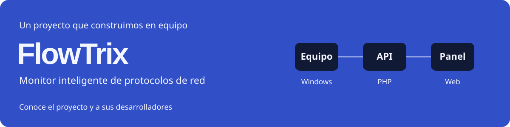
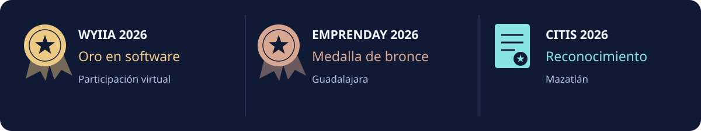
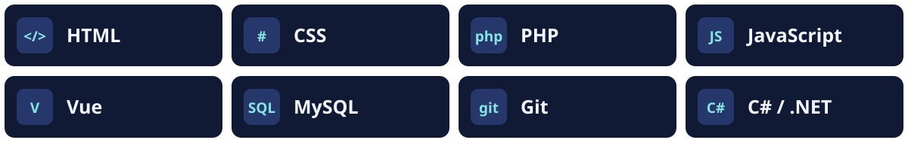

<picture>
  <source media="(max-width: 600px)" srcset="./assets/banner-mobile.svg" />
  
</picture>

  <a href="https://flowtrix.fimaz.uas.edu.mx/acerca-de">FlowTrix</a> &nbsp; / &nbsp;
  <a href="#tecnologías">Tecnologías</a> &nbsp; / &nbsp;
  <a href="https://revistas.uas.edu.mx/index.php/IJISTA/article/view/1828">Publicación</a> &nbsp; / &nbsp;
  <a href="https://github.com/NateStar20?tab=repositories">Repositorios</a>

Soy **Gerardo Sánchez**. Me interesa conectar el desarrollo web con las redes y construir herramientas que ayuden a entender lo que pasa en un sistema. He participado en proyectos académicos y colaborativos, y sigo aprendiendo con la práctica.

### FlowTrix, de un proyecto a los escenarios tecnológicos

<a href="https://flowtrix.fimaz.uas.edu.mx/acerca-de">
  <picture>
    <source media="(max-width: 600px)" srcset="./assets/flowtrix-mobile.svg" />
    
  </picture>
</a>

Formé parte del equipo de desarrollo de **FlowTrix: Monitor Inteligente de Protocolos de Red**, en la Facultad de Informática Mazatlán de la Universidad Autónoma de Sinaloa. La plataforma reúne información de los equipos y sus conexiones para apoyar el monitoreo y la auditoría de redes.

### Lo que logramos en equipo

<picture>
  <source media="(max-width: 600px)" srcset="./assets/logros-mobile.svg" />
  
</picture>

- **WYIIA 2026:** medalla de oro en software, con participación virtual en el certamen organizado en Indonesia. [Leer la noticia](https://www.entreveredas.com.mx/2026/11/estudiantes-de-la-uas-ganan-oro-con-un.html).
- **EMPRENDAY 2026:** medalla de bronce en Guadalajara. [Leer la noticia](https://www.debate.com.mx/amp/sinaloa/mazatlan/estudiantes-de-la-uas-en-mazatlan-ganan-medalla-de-bronce-con-flowtrix-20260909-0050.html).
- **CITIS 2026:** reconocimiento al equipo en Mazatlán por su resultado internacional. [Leer la cobertura](https://www.sinaloahoy.com.mx/portal/estudiantes-uas-mazatlan-oro-flowtrix/).

### Tecnologías

<picture>
  <source media="(max-width: 600px)" srcset="./assets/tecnologias-mobile.svg" />
  
</picture>

También he utilizado **PowerShell y GitHub**, y he explorado **FastAPI y Ollama**. Mi experiencia varía según la herramienta.

> **Bases que sigo fortaleciendo:** Python y Linux. Tengo conocimientos básicos y continúo practicando.

### Investigación que también se comparte

Soy coautor de [**FlowTrix: Arquitectura Persistente para el Monitoreo Proactivo y Detección de Vulnerabilidades en Redes Locales**](https://revistas.uas.edu.mx/index.php/IJISTA/article/view/1828), publicado en **IJISTA-UAS en 2026**.

### Código para explorar

| Repositorio | Qué encontrarás |
| :--- | :--- |
| [**NetMonitor**](https://github.com/NateStar20/Escaner-de-Red) | Auditoría y monitoreo de redes locales con agente de escritorio, servicio de Windows y MySQL. **C# / .NET / PowerShell** |
| [**Desarrollo Web Avanzado**](https://github.com/NateStar20/desarrollo-web-avanzado-fimaz-uas) | Evidencias académicas y ejercicios de desarrollo web con **PHP**. |

  <a href="https://github.com/NateStar20?tab=repositories"><strong>Ver todos mis repositorios</strong></a>

