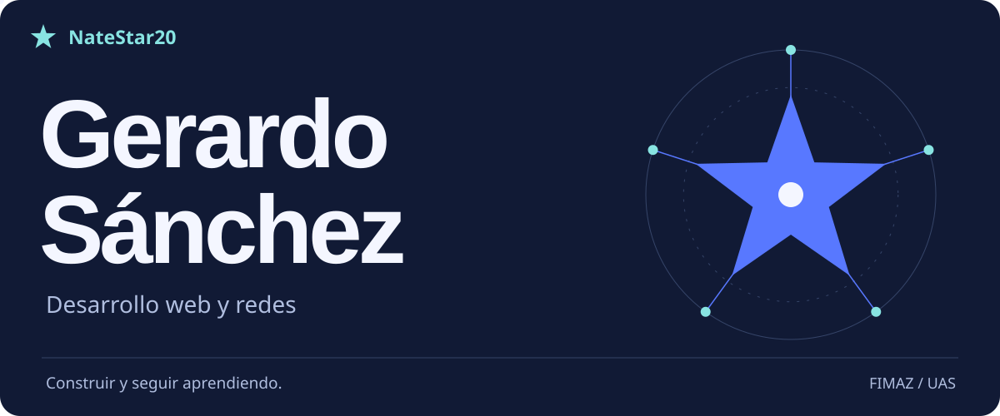

  

Construyo aplicaciones que conectan interfaces, APIs y bases de datos. Me interesa aplicar la IA a tareas concretas y crear herramientas que sean claras al usarlas y fáciles de mantener.

### En qué trabajo

- **Aplicaciones web:** interfaces con Vue, servicios con FastAPI y datos en MySQL.
- **IA aplicada:** integración de modelos locales y validación de sus respuestas.
- **Automatización y redes:** herramientas con C#, .NET y PowerShell.

### Proyectos públicos

| Proyecto | Qué encontrarás |
| :--- | :--- |
| [**NetMonitor**](https://github.com/NateStar20/Escaner-de-Red) | Sistema de auditoría y monitoreo de redes locales, con agente de escritorio, servicio de Windows y almacenamiento en MySQL. **C# · .NET · PowerShell** |
| [**Desarrollo Web Avanzado**](https://github.com/NateStar20/desarrollo-web-avanzado-fimaz-uas) | Repositorio académico de evidencias y ejercicios de desarrollo web. **PHP** |

### Tecnologías con las que trabajo

| Área | Herramientas |
| :--- | :--- |
| Interfaz | Vue 3, JavaScript, HTML y CSS |
| Servicios y datos | Python, FastAPI, PHP y MySQL |
| Automatización | C#, .NET y PowerShell |
| Entorno | Git, GitHub y Ollama |

---

[Explorar todos mis repositorios](https://github.com/NateStar20?tab=repositories)
